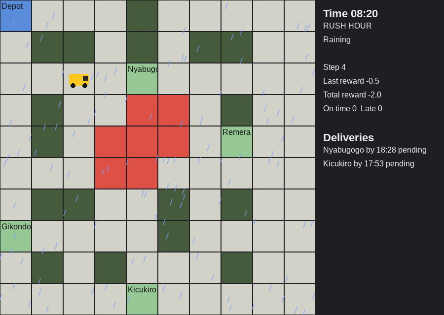

# Kigali Freight RL

A truck has to deliver goods across a simplified map of Kigali before each customer's deadline.
Traffic in the city centre gets heavy at rush hour (7-9, 17-19) and rain slows every road, so the
agent has to plan its route around time, traffic and weather. This connects to my capstone on truck
ETA prediction in Kigali: the travel-time model inside the environment plays the role of the ETA model.

Four agents are trained with **TorchRL** on the same environment: DQN, REINFORCE, A2C and PPO.



## Run it

```bash
uv sync
uv run main.py                 # best trained agent with the pygame window
uv run play.py --algo ppo      # best run of one method (dqn, reinforce, a2c, ppo)
uv run play.py --hard          # harder unseen setting: rain all shift, 3 tight deadlines
```

Random agent (no training), to see the environment only:

```bash
uv run python -m environment.rendering
```

## Train again

```bash
uv run python -m training.run_all        # all 41 configs, about 25 min on 20 CPU cores
uv run python -m training.dqn_training 1 # one DQN config
uv run python -m training.pg_training ppo_01_baseline
uv run python -m training.make_plots     # figures in assets/, tables in logs/tables.md
uv run pytest                            # environment tests
```

## Environment

| | |
|---|---|
| Actions (5) | up, down, left, right, wait 10 min |
| Observation (21 numbers) | truck x, y; time of day; raining; rush hour; for each of 4 stops: pending, time left before deadline, direction (dx, dy) |
| Reward | -0.1 per minute driven, +20 on-time delivery, +5 late delivery, -1 for hitting a wall, +0.5 per cell closer to the nearest stop, -10 per delivery not made when the shift ends |
| Start | depot, random start time 06:00-18:00, 2 random stops with deadlines 60-180 min away, 30% chance of rain |
| End | all stops delivered (success), or 4 hour shift / 150 steps over |

## Layout

```
environment/custom_env.py   the Gymnasium environment
environment/rendering.py    pygame drawing
training/dqn_training.py    DQN + 11 configs
training/pg_training.py     REINFORCE, A2C, PPO + 10 configs each
training/run_all.py         runs the whole sweep
training/make_plots.py      report figures and tables
models/                     saved networks
logs/                       results.csv, training curves, tables.md
play.py / main.py           run a trained agent
```
